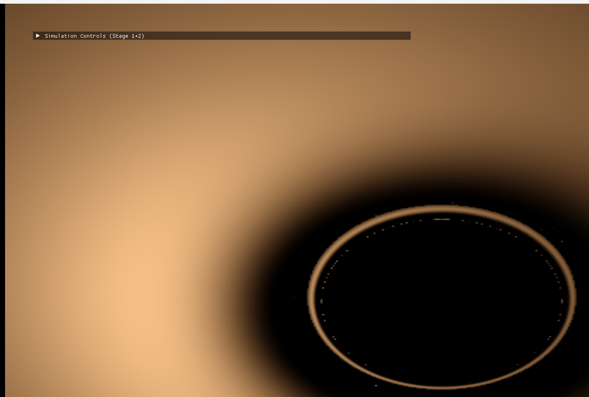
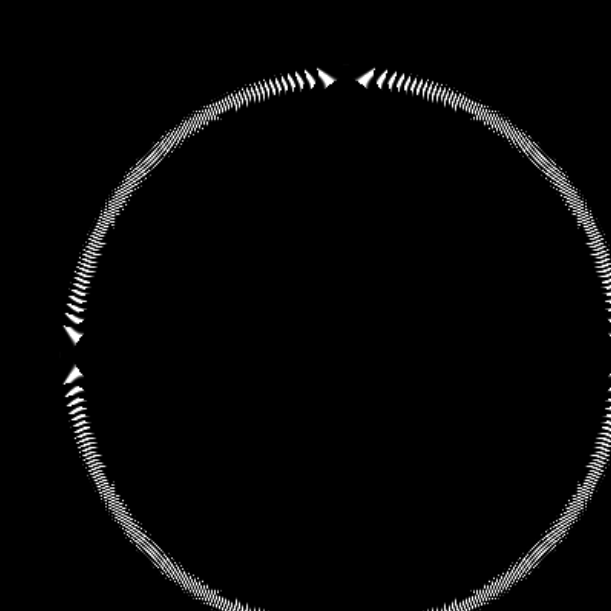

# Black Hole Ray-Tracing Simulator

A computational astrophysics project: a from-scratch C++/CUDA simulator
that computes how light actually propagates through curved spacetime
around a Schwarzschild black hole, by numerically integrating the null
geodesic equation — not by faking gravitational lensing with a screen-space
shader effect.

This is a physics simulation with a renderer attached, not a graphics demo
with physics-flavored decoration. Every visual result (the bent light,
the Einstein ring, the shadow, the lensed accretion disk) is the direct
numerical output of integrating General Relativity's equations of motion,
and every claim about that physics is backed by an automated test that
checks it against a known analytical result.

<p align="center">
  
  
</p>

*Left: an accretion disk, lensed — its far side visibly bent around behind
the shadow. Right: an Einstein ring, formed because pixels around the
shadow all happen to bend light from many different launch angles into
the same source direction. Neither image is drawn or warped; both are the
literal output of tracing photon geodesics.*

## What this demonstrates

- General relativity: the Schwarzschild metric, null geodesics, the
  photon sphere, gravitational lensing, the Einstein ring, the
  event-horizon/shadow distinction, gravitational + Doppler redshift.
- Numerical methods: RK4 integration, curvature-adaptive step control,
  a from-scratch closed-form Kepler-orbit reference for validating
  integrator error, documented failure modes and the fixes for them.
- C++: a modular physics/rendering/ray-tracing architecture, RAII,
  `std::execution::par` parallelism, a from-scratch OpenGL+ImGui
  application.
- CUDA: a from-scratch GPU port sharing its numerical core with the CPU
  path at the source level, validated bit-identical against the CPU
  output.
- Scientific rigor: 32 automated tests checking the code against known
  closed-form GR results — not "it looks right," but "it matches the
  analytical prediction to N significant figures, here's the number."

## Quick start

Requires Visual Studio 2022 (MSVC) on Windows; CMake and Ninja are used
via the ones bundled with VS. CUDA build additionally requires the CUDA
Toolkit (developed against 12.6) and an NVIDIA GPU.

```bat
:: CPU-only build (Stages 1-6 + Stage 7's CPU path; no CUDA toolkit needed)
build.bat
build\BlackHoleSimulator.exe
build\tests\BlackHoleTests.exe

:: CUDA-accelerated build (adds the GPU tracer)
build_cuda.bat
build_cuda\BlackHoleSimulator.exe
```

Everything else (GLFW, GLM, Dear ImGui) is fetched automatically by CMake
at configure time — nothing to install beyond the compiler/CUDA toolkit.

## What's in the app

An interactive ImGui control panel, organized by stage:

- **Stage 1 — Newtonian baseline**: a "control experiment." Test
  particles under ordinary `1/r²` gravity, integrated three ways (Euler,
  Velocity Verlet, RK4) simultaneously against the exact analytic Kepler
  orbit, so you can *see* each integrator's error and stability directly.
- **Stage 2 — Schwarzschild geodesics**: the same impact parameters
  traced as exact null geodesics instead, overlaid on Stage 1 for direct
  comparison — the point being that the Newtonian curve is *not* how
  light actually bends near a black hole.
- **Stage 3 — Gravitational lensing**: a real per-pixel backward ray
  tracer (CPU or GPU). Resolution presets from 160×90 up to 1920×1080,
  a procedural starfield background, live render-time/throughput readout.
- **Stage 4 — Einstein ring**: a point source locked to the camera's own
  forward axis (so camera/hole/source are automatically collinear at any
  orbit angle), plus a debug mode exposing individual ray paths, impact
  parameters, deflection angles, and closest approach.
- **Stage 5 — Shadow vs. horizon**: live readout of the shadow's true
  angular radius at the current camera distance versus the horizon's own
  (much smaller) angular size — the two are not the same thing, and the
  app shows you by how much.
- **Stage 6 — Accretion disk**: a Shakura-Sunyaev temperature profile,
  with a toggle to compare "relativistic effects on" (gravitational +
  Doppler redshift, relativistic beaming) against a flat, unshifted disk.
- **Stage 7 — CUDA**: a GPU/CPU toggle and a one-click "Validate: Compare
  CPU vs GPU" button reporting speedup and max/mean pixel-color
  difference between the two renderers.

## Documentation

- **[docs/physics.md](docs/physics.md)** — the theory: the Schwarzschild
  metric, the null-geodesic equation and why it's formulated the way it
  is, the photon sphere, the shadow/horizon distinction, the deflection
  angle, the Einstein ring, and the accretion-disk redshift derivation.
- **[docs/numerical_methods.md](docs/numerical_methods.md)** — the
  numerics: why each integrator was chosen, the adaptive step-size
  heuristic, every configurable tolerance and why it exists, two real
  bugs that were found and fixed (documented with the diagnosis), and
  how the CUDA kernel shares its numerical core with the CPU tracer at
  the source level rather than duplicating it.
- **[docs/validation.md](docs/validation.md)** — the results: every
  number below is copied directly from an actual test run, not
  paraphrased. Schwarzschild radius, photon sphere, critical impact
  parameter, weak-field deflection vs. the analytical formula (with the
  *next-order* correction also checked), the shadow-angle formula, ISCO
  orbital velocity, and a bit-identical CPU vs. GPU comparison with
  measured speedup.

## Architecture

```
src/
  Physics/      Pure C++ physics engine: BlackHole, GeodesicSolver,
                NewtonianIntegrator, KeplerOrbit, GeodesicMath (the
                __host__ __device__-shared ODE core). No GL/CUDA deps —
                unit-testable and reusable from the CUDA kernel verbatim.
  RayTracing/   CPUTracer and CUDATracer: same function signature, same
                output, different execution target.
  Rendering/    Camera, immediate-mode debug-view renderer, fullscreen
                texture blit for the ray-traced image.
  Astronomy/    StarField (procedural sky) and AccretionDisk (Shakura-
                Sunyaev temperature profile + blackbody color).
  Application/  App.cpp: GLFW/ImGui wiring and the interactive UI.
cuda/           geodesic_kernel.cu (the GPU kernel) and GeodesicKernel.h
                (a plain-C++ boundary header, so CUDA syntax never leaks
                into MSVC-compiled code).
tests/          32 checks against closed-form analytical GR predictions.
docs/           physics.md, numerical_methods.md, validation.md.
```

Physics is deliberately kept independent of rendering: `bh_physics` and
`bh_astronomy` build as standalone static libraries with no GL/CUDA
dependency, so they're unit-testable in isolation and the CUDA kernel
can call directly into the same header the CPU path uses.

## Limitations

This is explicitly a **Schwarzschild** (non-rotating, uncharged) model.
It does not implement black hole spin/Kerr spacetime, magnetic fields or
MHD, realistic disk radiative transfer, or flux-calibrated brightness —
see [docs/physics.md §10](docs/physics.md#10-limitations) for the full,
honest list of what this is and isn't. Where an approximation is made
anywhere in the code, it's labeled as such at the point it's made.

## Attribution

Built with [Claude Code](https://claude.com/claude-code).
